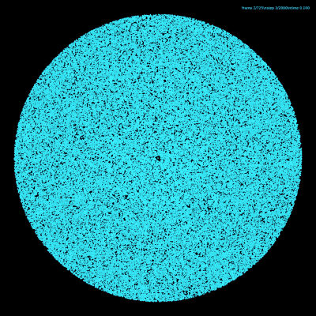
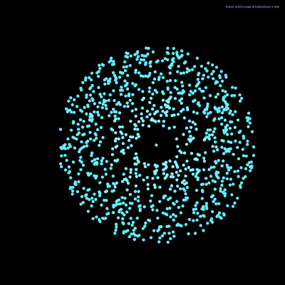
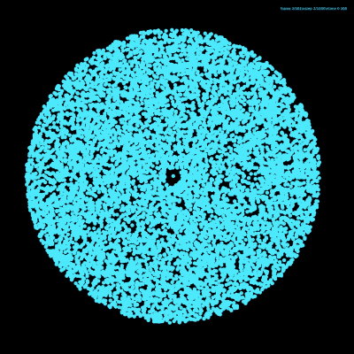

# N-Body Simulation: Barnes-Hut in C++, OpenMP and CUDA



A 2D gravitational N-body simulation using the Barnes-Hut algorithm, with
collisions, in three versions that share the same physics:

- **Serial C++17**: an O(N log N) Barnes-Hut quadtree and an O(N) grid-based
  collision broadphase.
- **OpenMP**: the same code, multithreaded. Output is byte-identical at any
  thread count.
- **CUDA**: the whole simulation runs on the GPU, using a Morton-ordered tree
  built in one cooperative kernel and lock-free collision resolution.

A naive O(N²) all-pairs version (CPU and GPU) is included as a baseline.

This project is a C++ port and extension of
[**DeadlockCode/barnes-hut**](https://github.com/DeadlockCode/barnes-hut), the
Rust implementation it is based on. See [Credits](#credits).

| 1,000 bodies | 10,000 bodies |
|:---:|:---:|
|  |  |

## Results

Wall-clock time per step (no trajectory output; mean of 5 runs, 320k is a
single run). Serial and OpenMP ran on CPU nodes of UQ's Rangpur cluster with
8 OpenMP threads; CUDA ran on an NVIDIA A100.

| Bodies | Serial (ms) | OpenMP, 8 threads (ms) | CUDA (ms) | OpenMP vs serial | CUDA vs serial | CUDA vs OpenMP |
|---:|---:|---:|---:|---:|---:|---:|
| 10k  |   6.03 |  1.59 | 0.98 | 3.8× |   6.1× |  1.6× |
| 20k  |  12.84 |  2.95 | 1.04 | 4.4× |  12.4× |  2.8× |
| 40k  |  27.35 |  6.20 | 1.12 | 4.4× |  24.5× |  5.6× |
| 80k  |  59.01 | 12.79 | 1.23 | 4.6× |  48.1× | 10.4× |
| 160k | 121.44 | 27.11 | 1.46 | 4.5× |  83.4× | 18.6× |
| 320k | 255.04 | 55.52 | 1.90 | 4.6× | 134.0× | 29.2× |

- **OpenMP** levels off at about 4.5× (57% efficiency on 8 threads). The
  Karp–Flatt serial fraction is about 11%. Most of it comes from collision
  resolution, which is kept sequential so results are identical to serial,
  and from memory bandwidth shared by all threads during tree traversal.
- **CUDA** time barely grows from 10k to 80k bodies (about 1.1× per doubling).
  At these sizes each step is dominated by fixed kernel-launch and
  synchronisation costs, not by the number of bodies. The speedup therefore
  keeps rising with N and hasn't levelled off at 320k.
- Writing trajectory frames to disk is excluded. On a network filesystem it
  can dominate the GPU run time.

On a serial profile (`gprof`, 80k bodies), the force calculation takes 80% of
the run time, collisions 16% and the tree build 4%.

## Building

Requirements: g++ with C++17 and OpenMP. For the GPU version, the CUDA toolkit
(tested with 12.2) and an NVIDIA GPU. For visualisation, Python 3 with the
packages in `requirements.txt`, and ffmpeg for MP4 output.

```bash
make            # ./sim         Barnes-Hut, OpenMP
make serial     # ./sim_serial  same code built without OpenMP
make naive      # ./naive_sim   O(N^2) baseline, OpenMP
make cuda       # ./sim_cuda, ./naive_sim_cuda, ./cuda_check (nvcc)
make cuda CUDA_ARCH=sm_89   # target another GPU (default sm_80, A100)
```

## Running

```bash
# <n_bodies> <total_steps> <output_every> [output.bin]
OMP_NUM_THREADS=8 ./sim 100000 1000 2 sim_output/run.bin   # write a frame every 2 steps
./sim 100000 1000 2                                         # timing only, nothing written
./sim_cuda 100000 1000 2 sim_output/run_gpu.bin             # same arguments on the GPU
./naive_sim 10000 100                                       # <n_bodies> <total_steps>
./cuda_check                                                # GPU kernels vs CPU reference
```

Each program prints its timing to stderr, for example:

```
BH: n=100000 threads=8 steps=1000 total_time=... ms avg_step=... ms compute_time=... ms avg_compute_step=... ms output_time=... ms
```

### Visualising

```bash
python3 -m venv .venv && . .venv/bin/activate && pip install -r requirements.txt
python3 load_sim.py sim_output/run.bin         # sanity-check a trajectory file
python3 run.py sim_output/run.bin -o run.mp4   # render (defaults to the newest file in sim_output/)
python3 run.py run.bin --format gif --stride 2 --fps 30
python3 run.py big.bin --min-marker 0.05 --alpha 0.4   # tiny, translucent dots for ~1M bodies
```

The `.bin` format (`NBS2`) is documented at the top of
[`src/Main.cpp`](src/Main.cpp) and [`load_sim.py`](load_sim.py). It has a
header, per-body mass and radius written once, then `[x, y, vx, vy]` float32
per body per frame. Index `i` is always the same body. Runs that are killed
partway still produce a readable, truncated file.

### On a Slurm cluster

The scripts in [`cluster/`](cluster/) were written for UQ's Rangpur cluster.
Change `--account`, `--partition` and the CUDA module for another cluster.
Run them from the project root:

```bash
cluster/run.sh 5                          # 5 OpenMP timing runs (threads = --cpus-per-task)
cluster/run.sh 5 cpu --cpus-per-task=1    # single-threaded runs
cluster/run.sh 3 cuda                     # GPU runs (also runs cuda_check)
cluster/run.sh 1 cuda visual              # also write a .bin for run.py
cluster/times.sh                          # summarise the job logs: times, speedups, efficiency
```

## How it works

Each step runs **integrate** (semi-implicit Euler), then **collide**, then
**build the tree and compute forces**.

- **Quadtree** ([`QuadTree.cpp`](src/QuadTree.cpp)): rebuilt every step by
  partitioning the body array in place, so each node owns a contiguous range
  of bodies. Leaves hold up to 16 bodies. Nodes live in one flat array with
  precomputed `next` skip pointers, so traversal needs no recursion or stack.
  The opening criterion is `size² < d²·θ²` with θ = 1 and softening ε = 1. Leaf
  loops are unrolled four ways and use a fast inverse square root.
- **Collisions** ([`Collision.cpp`](src/Collision.cpp)): a uniform grid with
  cells of about the median body diameter, binned by counting sort and
  searched with a half-stencil, so each pair is tested once. The heavy
  central body is checked against everyone separately. Pairs are resolved in
  a fixed order, so results are deterministic.
- **OpenMP**: the force loop uses a dynamic schedule, and the tree is built
  level by level in parallel, reproducing the serial layout exactly. The
  collision search runs in parallel with per-thread pair lists and a parallel
  sort. There are no floating-point reductions, so output is identical at
  any thread count.
- **CUDA** ([`src/cuda/`](src/cuda/)): everything stays on the GPU, stored as
  structure-of-arrays.
  - The tree is built from Morton codes, a stable CUB radix sort and a single
    cooperative kernel with `grid.sync()` between levels. It gives the same
    node layout as the CPU, and forces agree to about 1e-7.
  - Collisions use one thread per body, gathering contacts from a radix-sorted
    grid. Contacts are combined Jacobi-style, so no thread writes another
    body. This removes the serial pass and needs no atomics, but bodies with
    several simultaneous contacts resolve differently from the CPU. GPU
    trajectories therefore match the CPU statistically, not bit-for-bit.
  - Runs are deterministic: there are no float atomics and all sorts are
    stable.

## Project layout

```
src/            serial/OpenMP simulation (Main.cpp, QuadTree, Collision, ...)
src/naive/      O(N^2) baseline
src/cuda/       GPU simulation, naive GPU baseline and cuda_check test suite
cluster/        Slurm job scripts and log summariser
load_sim.py     reader for .bin trajectory files
run.py          renders a trajectory to MP4/GIF
img/            example renders
```

## Credits

This is a C++ port and extension of
[barnes-hut](https://github.com/DeadlockCode/barnes-hut) by
**DeadlockCode**, the Rust implementation from the video *How to make HUGE
N-Body Simulations (N=1,000,000+)*. The quadtree design, force law, initial
conditions and collision response come from that project. The grid
broadphase, OpenMP parallelisation, CUDA implementation and benchmarking
tooling were added here. The original is dual-licensed under MIT or
Apache-2.0; its notice is in [`NOTICE`](NOTICE).

Developed for COSC3500 (High-Performance Computing) at the University of
Queensland.

## License

Licensed under either of

- Apache License, Version 2.0 ([LICENSE-APACHE](LICENSE-APACHE))
- MIT license ([LICENSE-MIT](LICENSE-MIT))

at your option.
